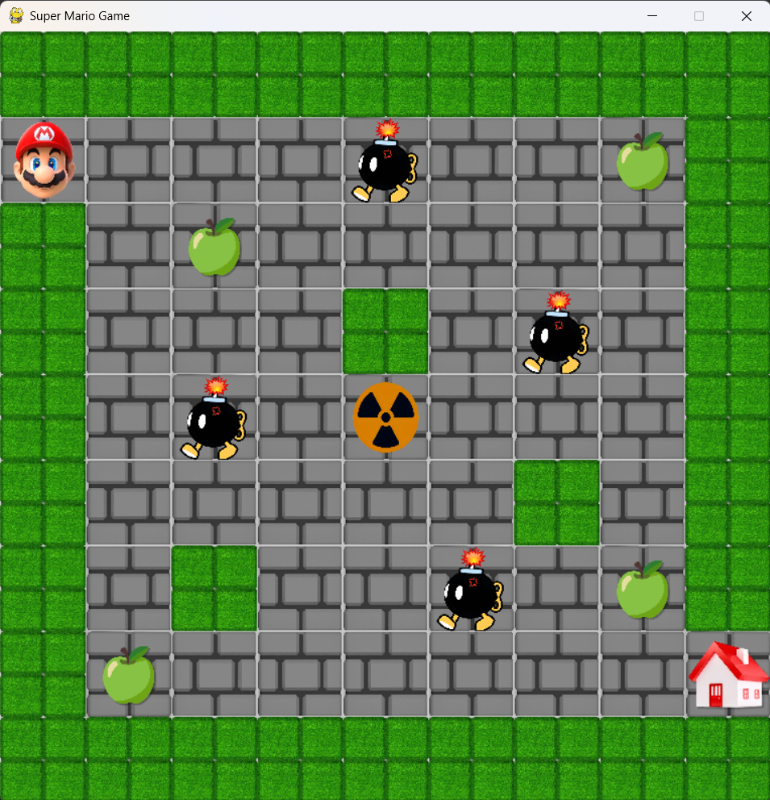
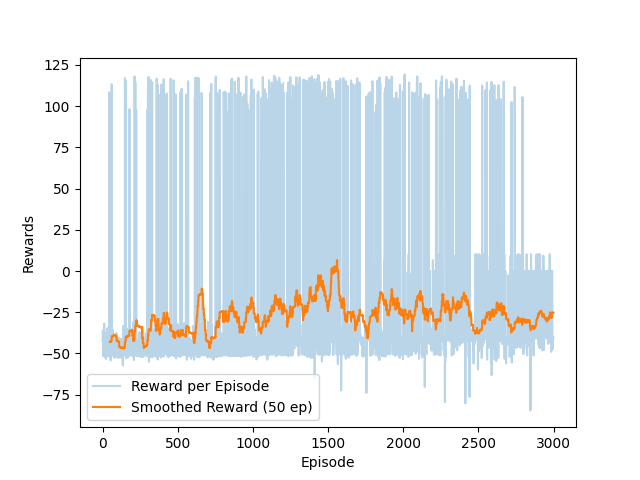

# DQN Mario Grid World

A Deep Q-Network (DQN) agent trained to navigate a Mario-themed grid world, built with **PyTorch**, **Gymnasium** and **Pygame**.
Course project for *Principles of Autonomy and Decision Making* at Technische Hochschule Ingolstadt (THI).



## What's in this repo

| Part | Description |
|---|---|
| Two custom Gymnasium environments | A 6×6 training grid and a full 9×9 "Super Mario" grid with walls, bombs, hell states and power-ups |
| DQN agent | MLP Q-network, target network, experience replay, ε-greedy exploration |
| Manual play mode | Drive Mario with the arrow keys to check the environment dynamics and rewards |
| Results | Training curves, a trained-agent demo and manual-play demos in [`Result/`](Result) |

## Project structure

```
├── DQN_model.py        # Q-network (2 → 128 → 128 → 4) + ε-greedy action selection
├── utils.py            # Replay buffer and DQN update step
├── padm_env.py         # 6×6 environment (used for DQN training)
├── env_dhm1382.py      # 9×9 Super Mario environment (manual play + rendering)
├── main.py             # Train / test DQN on the 6×6 environment
├── main_dhm1382.py     # Train / test DQN on the 9×9 environment
├── Photos/             # Sprites
└── Result/             # Demo videos, environment overview, console output
```

## Environments

| | 6×6 grid (`padm_env.py`) | 9×9 Super Mario (`env_dhm1382.py`) |
|---|---|---|
| Start → Goal | (0, 0) → (5, 5) | (1, 0) → (7, 8) |
| Terminal failure | 4 bombs | 1 hell state (radiator) |
| Other elements | 3 food items | Walls, 4 bombs, 4 power-ups (Mario → Super Mario) |
| Rewards | Goal +100 · bomb −50 · food +10 (−1 if revisited) | Goal +10 · hell/bomb −5 · power-up +5 · safe step +1 |
| Purpose | DQN training | Visual validation, manual play |

**Why two environments?** The 9×9 world renders every step with Pygame, which makes it slow to train in. The 6×6 grid keeps the same state/action interface (state = (row, col), 4 actions) but is small enough to run thousands of episodes, so it is the main DQN training environment.

## Method

- **Q-network:** `Linear(2,128) → ReLU → Linear(128,128) → ReLU → Linear(128,4)`; input is the agent's (row, col) position, output is one Q-value per action (Up, Down, Right, Left).
- **Target network:** a copy of the Q-network, synced every 10 episodes, to stabilise the TD target.
- **Experience replay:** buffer of 50,000 transitions; training starts after 500 samples, 10 mini-batch updates per episode.
- **Loss:** Smooth L1 (Huber) on `r + γ · max_a' Q_target(s', a')`, with gradient clipping (max norm 1.0).
- **Exploration:** linear ε decay `ε = max(0.01, 1 − 0.99 · episode / N)`, from 1.0 down to 0.01.

| Hyperparameter | Value |
|---|---|
| Optimizer / learning rate | Adam / 0.01 |
| Discount γ | 0.98 |
| Batch size | 32 |
| Episodes / max steps | 3,000 / 100 (6×6), 200 (9×9) |

The DQN training loop is adapted from [minimalRL](https://github.com/seungeunrho/minimalRL/blob/master/dqn.py); the environments, reward design and experiments are my own.

## Results

**6×6 environment, 3,000 episodes:**



- The agent reaches the goal (+100) regularly while exploration is high (ε > ~0.15), so the environment and reward signal work.
- The **greedy policy did not converge**: the 50-episode moving average stays between about −40 and 0, and once ε is low the agent mostly ends episodes in a bomb or by timing out.
- A demo of the trained agent is in [`Result/dqn_agent_6x6_demo.mp4`](Result/dqn_agent_6x6_demo.mp4).

**9×9 environment:** mainly used for manual play and validation ([`Result/manual_agent_9x9_demo.mp4`](Result/manual_agent_9x9_demo.mp4)). Its +1 reward for every safe step lets the agent collect more reward by wandering than by finishing (goal = +10), so it is not yet suited to DQN training.

### Lessons learned / next steps

- **Reward shaping:** in the 9×9 world, use a small step *penalty* instead of +1 so reaching the goal is the best strategy.
- **Markov state:** the food reward depends on which items have been collected, but the state is only (row, col). Adding "collected" flags to the observation should make the problem learnable.
- **Stability:** normalise the state to [0, 1], lower the learning rate (e.g. 1e-3), and update the network every step rather than once per episode.
- **Evaluation:** report success rate and average path length over test episodes instead of only the training reward.

## How to run

```bash
pip install torch gymnasium pygame numpy matplotlib

python main.py            # train DQN on the 6×6 grid
python main_dhm1382.py    # train DQN on the 9×9 grid
python env_dhm1382.py     # play the 9×9 world manually with the arrow keys
```

To test a trained model, set `train_dqn = False` and `test_dqn = True` at the top of the main file. Training saves the weights as `dqn.pth` / `dqn_dhm1382.pth` (not included in the repo). Set `render = False` for much faster training.

## Author

**Dharmik Mangukiya** · Master's student, AI Engineering of Autonomous Systems, THI
